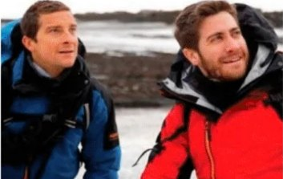
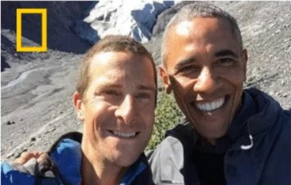
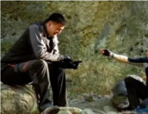
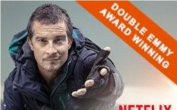
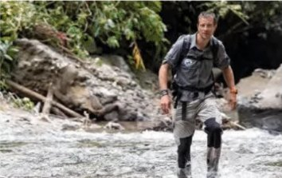
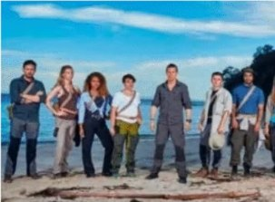

## Die Gelegenheit

!! Was, wenn Lidl Familien zusammenbringt — mit einem Abenteuer, das sie sehen,
kaufen und erleben können?

Eine international bekannte Figur. Zwei **fertig produzierte** Animationsfilme.
Und mit Lidl Plus ein Kanal, der aus Aufmerksamkeit einen Einkauf macht und aus
einem Einkauf ein gemeinsames Erlebnis.

Das ist kein Logo auf Ware. Es ist eine Kette: Die Geschichte weckt Interesse,
das Produkt macht sie greifbar, das Erlebnis gibt der Familie einen Grund
mitzumachen.

## Wer Bear Grylls ist {hell}

::: reiter
### Der Mann
bild: bilder/bear-live.jpg
Soldat der 21 SAS, Everest-Besteiger, Ehrenoberst, Nummer-1-Bestsellerautor und Fernsehabenteurer. Seit zwanzig Jahren dieselbe Rolle: der Mann, der zeigt, wie man durchkommt.

Von Juli 2009 bis September 2024 **Chief Scout des Vereinigten Königreichs** — der jüngste je ernannte, nach Baden-Powell der am zweitlängsten amtierende. Seit 2018 **erster Chief Ambassador of World Scouting**.

Botschafter des Tusk Trust. Sein Satz unter jeder Unterschrift: *Never give up.*

### Die Reichweite
Über **zwei Milliarden** Fernsehzuschauer in mehr als **200 Ländern und Territorien**. **20 Millionen** verkaufte Bücher in 30 Sprachen.

Ausgestrahlt wurde er unter anderem bei Netflix, BBC, Discovery, National Geographic, NBC, ITV, Disney und Apple TV+.

Die aktuellen Social-Media-Zahlen stehen im nächsten Abschnitt.

### Warum das für Familien zählt
Als Galionsfigur für **60 Millionen Pfadfinder** weltweit steht er nicht für Hype, sondern für Haltung: Draußen sein, nicht aufgeben, einander helfen.

Das ist der Unterschied zu einer beliebigen Lizenzfigur. Eltern müssen bei dieser Marke nicht überlegen, ob sie dazu passt — sie kennen sie und sie vertrauen ihr.
:::

## Was er gedreht hat

::: galerie drei

:::

Dazu zwei Netflix-Produktionen, die zum Start jeweils auf **Platz 1** standen:
*Celebrity Bear Hunt* und *Animals on the Loose*.

## Die Reichweite heute {hell}

!! Eine Lizenzfigur ist nur so viel wert wie die Aufmerksamkeit, die sie
mitbringt. Diese hier bringt ein eigenes Publikum mit — jeden Tag, ohne
Mediabudget.

::: belege
Facebook, verifizierte Seite | 13 Mio. | Facebook-Seite, abgerufen am 26.10.2026
Instagram, verifiziertes Profil @beargrylls | 8,6 Mio. | Instagram-Profil, abgerufen am 26.10.2026
YouTube @beargrylls, dazu 255 Videos | 635.000 | YouTube-Kanal, abgerufen am 26.10.2026
TikTok @beargrylls, dazu 2,6 Mio. Likes | 428.900 | TikTok-Profil, abgerufen am 26.10.2026
:::

**Vier Plattformen, nachgezählt: rund 22,7 Millionen Follower.** X und Weibo
sind darin noch nicht enthalten. Der Lizenzgeber nennt 23 Millionen über alle
Kanäle — die Einzelzahlen bestätigen das, statt es nur zu behaupten.

Dazu kommt Reichweite, die keine Followerzahl abbildet: Eine einzige
YouTube-Folge mit dem indischen Premierminister erreichte **3,6 Milliarden
Online-Impressionen**, das offizielle Promo zu *Into the Wild* mit Akshay Kumar
allein **24,5 Millionen Aufrufe**. Die Schwerpunkte liegen in Großbritannien,
den USA, **Indien und China**.

**Was das für eine Kampagne bedeutet:** Reichweite muss nicht eingekauft
werden, sie ist vorhanden. Bear wäre laut Konzept über Premieren, Interviews,
PR-Termine und seine eigenen Kanäle eingebunden — vorausgesetzt, seine
persönliche Mitwirkung wird vertraglich gesichert.

::: kapitel bilder/keyart-band.jpg
nummer: Der Inhalt
## Zwei Filme sind fertig.

Kein Entwicklungsprojekt, keine Absichtserklärung. Zwei abgeschlossene
Animationsfilme, die auf einen Starttermin warten.
:::

## Die Geschichte

!! **Green Squad** — ein fünfköpfiges Einsatzteam in einer verdeckten
Rettungsorganisation, die ausschließlich von Kindern geführt wird: dem
**Secret Ops Squad**.

Der neueste Rekrut ist ein vierzehnjähriger Bear Grylls. Ein eher gewöhnlicher
Junge — unsicher, in der Schule gelangweilt —, bis er rekrutiert wird. Erzählt
wird, wie er seinen Platz im Team findet: waghalsige Rettungen, extreme
Schauplätze, knappes Überleben und Freundschaften, die halten.

Schnell, komisch und spannend. Für Bears junge Fans die Vorgeschichte zu dem
Mann, den sie aus dem Fernsehen kennen.

::: karten zwei
### Endangered · 91 Minuten
Schauplatz: die Dschungel von Borneo und Sumatra. Bear tauscht das Klassenzimmer gegen den Regenwald und steht an vorderster Front gegen Abholzung und Artensterben. Tödliche Raubtiere, ein wütendes Nashorn und ein paar zu freundliche Orang-Utans.

Die härteste Prüfung ist eine andere: Bear muss seine Teamkameraden — und sich selbst — davon überzeugen, dass er in die Truppe gehört.

### Icebreaker · 96 Minuten
Schauplatz: Sibirien und der Polarkreis. Ein abgestürztes Frachtflugzeug, Menschenleben in Gefahr und die Uhr läuft, bei Temperaturen weit unter null.

Dazu Whiteout-Stürme, Wölfe und eine Lawine. Diesmal muss die Green Squad vor allem eines: sich selbst retten.
:::

!! **Der Vorschlag:** ein exklusives Ansichtsfenster für Lidl-Kundinnen und
-Kunden — vorbehaltlich Rechten, Territorien und technischer Machbarkeit.

// VIDEO: Sobald eine Trailerdatei vorliegt, hier die beiden Schraegstriche
// entfernen und die Datei als bilder/trailer.mp4 ablegen.
// ::: video bilder/trailer.mp4
// poster: bilder/keyart-hero.jpg
// titel: Endangered — Trailer
// :::

## Der Mechanismus: Lidl Plus

!! Hier entsteht der eigentliche Wert. Nicht in der Lizenz, sondern in der
Verbindung von Regal, App und Film.

::: bildwand bilder/lidl-plus-foto.jpg
### Entdecken
Die Kampagne im Markt: Aktionsfläche, Handzettel, Regal.

### Kaufen
Aktionsprodukte mitnehmen — die Schwelle entscheidet über die Wirkung.

### Freischalten
QR-Code einlösen, Zugang über Lidl Plus erhalten.

### Ansehen
Den Film zu Hause gemeinsam schauen. Kein Streamingdienst dazwischen.

### Wiederkommen
Zurück in den Markt für das nächste Abenteuer.
:::

::: belege
Nutzer der Lidl-Plus-App weltweit, nach Angaben von Lidl | über 100 Mio. | Lidl, zitiert in Presseberichten; Angabe rund ein Jahr alt
:::

**Was vorher zu klären ist**, und das sagen wir lieber jetzt als später:
Einkaufsschwellen, Teilnahmebedingungen und der Schutz von Kinderdaten. Das
gehört in die Machbarkeitsprüfung, nicht in eine Präsentation.

## Was daraus entsteht {hell}

::: reiter
### Die Produkte
Schmal starten, nicht breit. Eine eng kuratierte Kollektion schlägt ein großes Sortiment ohne Haltung.

- **Kinder-Explorerjacken** und praktische Familienbekleidung
- **Rucksäcke** und **Trinkflaschen**
- **Camping-Basics** und **Outdoor-Spiele**
- **Ausgewählte Snacks** aus der Mission-Food-Linie

Jedes Produkt braucht einen klaren Preispunkt und einen glaubwürdigen Grund zu existieren. Gemeinsame Entwicklung ist ausdrücklich vorgesehen: Lidl kennt Preislagen und Fläche, die Lizenzseite bringt Figur, Bildwelt und Geschichte.

### Das Erlebnis
Familien-Abenteuerwochenenden. Naturchallenges. Ferienaktionen. Sorgfältig gestaltete Gewinnerlebnisse.

Die Kampagne soll Erinnerungen schaffen, nicht Impressionen zählen.

Darüber hinaus — ausdrücklich als Zusatz, nicht als Fundament — ließe sich das Thema mit bestehenden Lidl-Initiativen zu Nachhaltigkeit und Familie verbinden. Ein konkretes Programm wäre mit Ihrem CSR-Team zu entwickeln, mit messbaren Ergebnissen und belegbaren Umweltaussagen.

### Der Geschäftsnutzen
**Für Lidl:** Kategorieumsatz und Frequenz. Kundenbindung über Lidl Plus. Eine unverwechselbare Markenerzählung in den Schlüsselmärkten — etwas, das kein Wettbewerber einfach nachkaufen kann.

**Für die Rechteinhaber:** Lizenzwert, Filmreichweite und die Perspektive auf ein dauerhaftes Franchise statt einer einmaligen Aktion.

Gemessen wird der Pilot an inkrementellen Ergebnissen — nicht an Reichweitenzahlen in einer Abschlusspräsentation.
:::

## Die Marke steht nicht allein

::: reiter
### Das Franchise
Hinter den beiden Filmen steht ein ausgearbeitetes Franchise: Animationsserie, Live-Action-Film, Spielzeug und Konstruktionsspielzeug, Bekleidung und Schuhe, Outdoor-Ausrüstung, Verlagsprogramm, Gaming, robuste Smartphones, Food und Nutrition, Musik, Adventure Travel sowie Erlebniszentren und Themenparks.

Für Lidl heißt das: Eine Aktion kann wachsen, statt nach einer Saison zu verpuffen.

### Bestehende Partner
**Jack Wolfskin** — eine globale Zusammenarbeit mit eigenem „Discovery Team". Eine deutsche Outdoor-Marke, die dieselbe Zielgruppe anspricht.

**Luminox** — offizieller Uhrenpartner, Schweizer Abenteueruhren.

Beide zeigen, dass die Marke im Handel funktioniert und Partner findet, die etwas zu verlieren haben.

### Erlebnisse, die es gibt
Die **Survival Academy** arbeitet weltweit. In Großbritannien laufen **The Bear Grylls Adventure** und das Festival **Gone Wild**. In China ist ein Themenpark in Planung.

Das ist keine Idee für später, sondern eine bestehende Infrastruktur, an die sich eine Handelskampagne anhängen kann.
:::

::: belege
Europäischer Markt für Outdoor-Ausrüstung, 2025 | 21,7 Mrd. € | Lizenzunterlagen YBG Films Ltd, 2025; Prognose +7,5 % jährlich bis 2030
Globaler Markt für Fertiggerichte, Prognose 2031 | 231 Mrd. $ | Lizenzunterlagen YBG Films Ltd, 2025 (2022: 140 Mrd. £)
:::

Für die Lebensmittelschiene laufen bereits Gespräche mit großen Supermärkten;
der Start ist in Großbritannien vorgesehen. **Wer früh einsteigt, bestimmt
mit, wie die Marke im Handel aussieht.**

## Was wir vorschlagen

::: zeitplan
Erstens | Eine fokussierte Arbeitssitzung mit der Lidl-Führung
Zweitens | Die strategische Passung festhalten — oder das Thema beenden
Drittens | Rechte- und Machbarkeitsprüfung beauftragen
Viertens | Einen Pilotmarkt auswählen
Fünftens | Einen kommerziell belastbaren Launchplan bauen
:::

Ein Familienabenteuer, das bei Lidl beginnt — und weit darüber hinausgeht.
